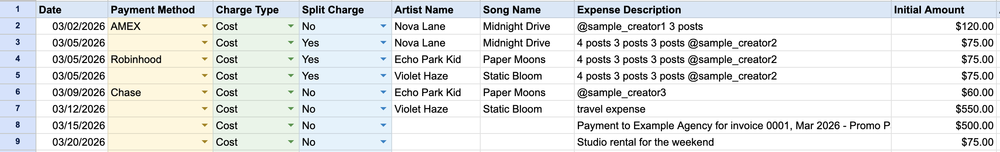

# PayPal to Google Sheets Automation

A Python script that turns monthly PayPal CSV exports into organized Google Sheets expense tracking. It pairs each payment with its card charge, parses structured notes into artist / song / description columns, splits shared costs across multiple artists, and builds a formatted tab for each month.

I built this during an internship to replace a manual process: a monthly PayPal export was being retyped into a spreadsheet by hand, which was slow and error-prone. All names, amounts and emails in this repo are fake sample data.



## Features

- Pairs each outgoing payment row with its matching **General Card Deposit** row (via `Reference Txn ID`)
- Uses the **USD card charge** as the source of truth, so foreign-currency payments and currency-conversion rows are handled correctly
- Parses `"Song - Artist" description` notes into separate columns
- Splits one payment evenly across multiple artists (one row per artist, `Split Charge = Yes`)
- Handles invoice payments (uses the invoice Item Title as the description)
- Falls back gracefully: notes that don't match the format go entirely into the description column and are logged for review
- Creates or appends to a monthly tab (`March 2026`, ...), sorted newest-first
- Applies dropdown validation, light styling, auto-sized columns, and a `Final Amount` formula (`=H2+I2`)
- Retries Google API calls with exponential backoff

## Tech

Python, pandas, gspread, gspread-formatting, Google service-account authentication.

## Try it with sample data

`sample_data/sample_paypal.csv` is a fake PayPal export covering a single payment, a three-artist split, a GBP payment charged in USD, a payment with a fee, an invoice, and a malformed note. After setup (below), run:

```bash
python paypal_to_sheets.py sample_data/sample_paypal.csv
```

Expected rows for the sample (Payment Method is left blank for manual entry):

| Date | Charge Type | Split | Artist | Song | Description | Initial | Fees |
|------|-------------|-------|--------|------|-------------|---------|------|
| 03/02/2026 | Cost | No | Nova Lane | Midnight Drive | @sample_creator1 3 posts | $120.00 | $0.00 |
| 03/05/2026 | Cost | Yes | Nova Lane | Midnight Drive | (shared description) | $75.00 | $0.00 |
| 03/05/2026 | Cost | Yes | Echo Park Kid | Paper Moons | (shared description) | $75.00 | $0.00 |
| 03/05/2026 | Cost | Yes | Violet Haze | Static Bloom | (shared description) | $75.00 | $0.00 |
| 03/09/2026 | Cost | No | Echo Park Kid | Paper Moons | @sample_creator3 | $60.00 (USD charge, not the GBP amount) | $0.00 |
| 03/12/2026 | Cost | No | Violet Haze | Static Bloom | travel expense | $550.00 | $16.25 |
| 03/15/2026 | Cost | No | (blank) | (blank) | Payment to Example Agency for invoice 0001, ... | $500.00 | $0.00 |
| 03/20/2026 | Cost | No | (blank) | (blank) | Studio rental for the weekend | $75.00 | $0.00 |

## Setup

1. Clone the repo and create a virtual environment:
   ```bash
   python3 -m venv venv
   source venv/bin/activate
   pip install -r requirements.txt
   ```
2. Create Google Sheets credentials (below) and save the key as `credentials.json` in the project root.
3. Copy the example config and add your own Sheet ID:
   ```bash
   cp config.example.py config.py
   ```
4. Put PayPal CSV exports in `paypal_csvs/`, then run `python paypal_to_sheets.py`.

### Google Sheets API credentials

1. In [Google Cloud Console](https://console.cloud.google.com/), create a project and enable the **Google Sheets API**.
2. Go to **APIs & Services > Credentials > Create Credentials > Service Account**.
3. Open the service account, go to **Keys > Add Key > Create new key > JSON**, and save it as `credentials.json`.
4. Open your Google Sheet, click **Share**, and add the service account's `client_email` (found in `credentials.json`) as an **Editor**.
5. Copy the Sheet ID from the URL (`.../spreadsheets/d/<SHEET_ID>/edit`) into `config.py`.

## Usage

```bash
# Process every CSV in paypal_csvs/
python paypal_to_sheets.py

# Process one file
python paypal_to_sheets.py path/to/transactions.csv
```

The month is detected from the **dates inside the CSV**, not the filename. Running the same CSV twice appends duplicate rows, so move processed files to `processed_csvs/`.

## PayPal note format

Single payment:
```
"Song Name - Artist Name" description
```
Example: `"Midnight Drive - Nova Lane" @sample_creator 5 posts`

Split payment (multiple artists, cost divided equally):
```
"Song1 - Artist1" deliverable1 "Song2 - Artist2" deliverable2 @shared_info
```

Song and artist must be inside straight ASCII quotes with a dash between them. Text outside the quotes becomes the Expense Description.

## How the amounts work

Each outgoing payment appears in the CSV as two linked rows:

1. `Mobile Payment` or `BillPay transaction`: contains the note, fee and recipient
2. `General Card Deposit`: contains the actual USD amount charged

| Column | Source |
|--------|--------|
| Final Amount | Formula `=H+I` (Initial + Fees) |
| Initial Amount | USD card charge minus fees |
| Additional Fees | Fee on the payment row |

`General Currency Conversion` rows are ignored.

## Output columns

Date, Payment Method (dropdown, left blank on purpose because PayPal exports don't say which card funded a payment), Charge Type (dropdown: Cost / Reimbursement), Split Charge (dropdown: Yes / No), Artist Name, Song Name, Expense Description, Initial Amount, Additional Fees, Final Amount.

## Security

This tool handles financial data, so these files are gitignored and must never be committed: `credentials.json`, `config.py`, and the `paypal_csvs/` and `processed_csvs/` folders. If a key is ever exposed, delete it in Google Cloud Console and create a new one.

## Known limitations

- Payment Method must be filled in manually
- Invoice rows need Artist and Song entered manually
- No duplicate detection when the same CSV is processed twice
- In split payments, every row gets the same combined description rather than only that artist's own deliverable
- Runs from the command line; it is not a scheduled or real-time sync

## Project structure

```
paypal-automation/
├── paypal_to_sheets.py   # Main script
├── config.example.py     # Copy to config.py and edit
├── requirements.txt
├── sample_data/
│   └── sample_paypal.csv # Fake PayPal export for trying it out
└── README.md
```
